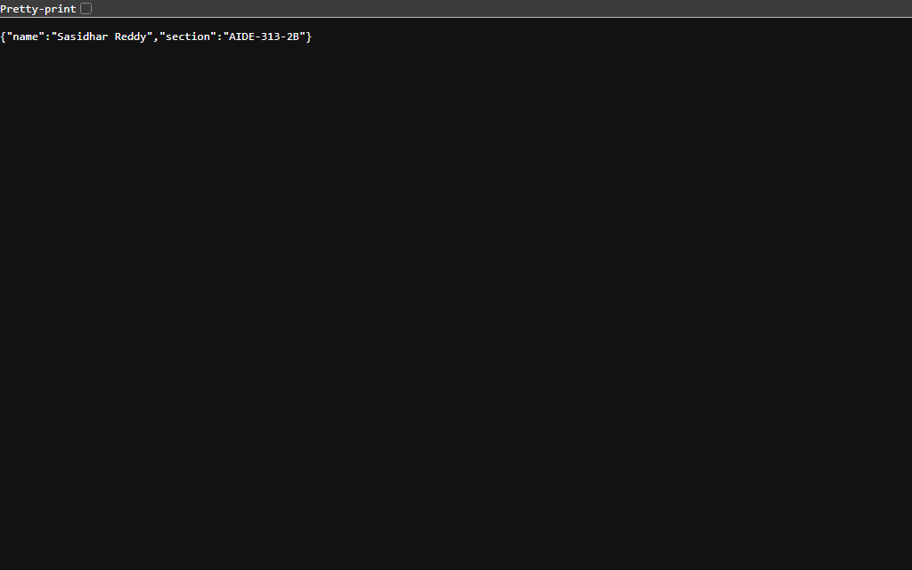
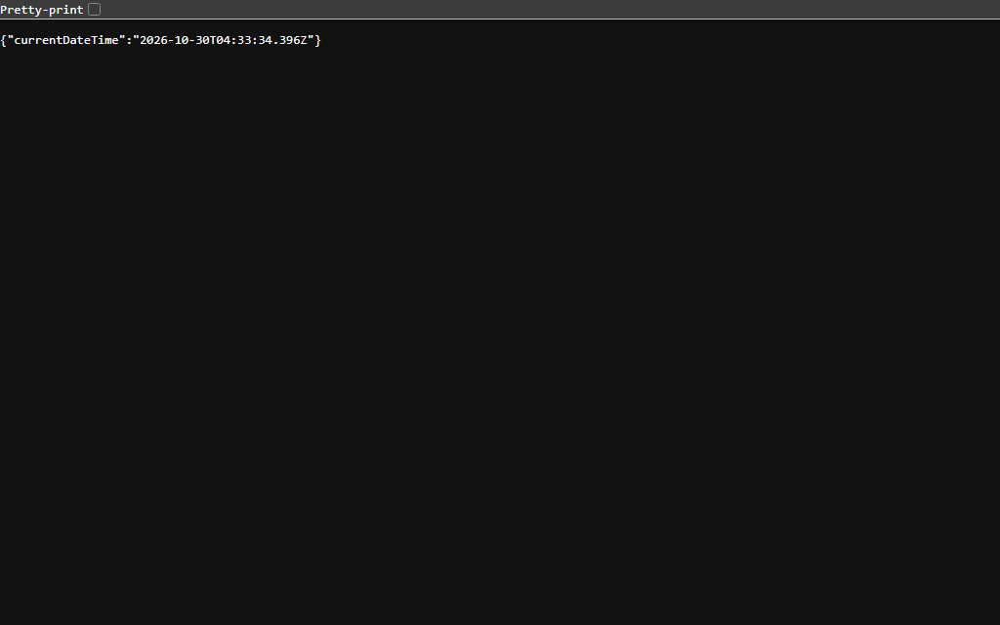

# Lab 1: Node.js and Express server

**Sasidhar Reddy** · **Registration Number: [Your Registration Number]** · **Section: AIDE-313-2B**

---

### Live Link
- **Deployment URL**: [https://lab-01-node-express.onrender.com](https://lab-01-node-express.onrender.com) *(or `Not applicable` if running locally in development mode)*
> **Note**: For local evaluation, the server runs at `http://localhost:3000`. Detailed steps to deploy to Render/Railway are included below.

---

## Table of Contents
1. [Project Overview](#project-overview)
2. [How to Run](#how-to-run)
   - [Prerequisites](#prerequisites)
   - [Installation](#installation)
   - [Environment Variables](#environment-variables)
   - [Starting the Servers](#starting-the-servers)
3. [Endpoints Table](#endpoints-table)
4. [Screenshots of Working Output](#screenshots-of-working-output)
5. [Task Walkthrough & Concept Explanations](#task-walkthrough--concept-explanations)
   - [Task 1: Explanation of `package.json` Fields](#task-1-explanation-of-packagejson-fields)
   - [Task 2: Locating Express in `node_modules`](#task-2-locating-express-in-node_modules)
   - [Task 3: Plain HTTP Server (`server-http.js`)](#task-3-plain-http-server-server-httpjs)
   - [Task 4 & 5 & 6: Express Server (`app.js`)](#task-4--5--6-express-server-appjs)
   - [Task 7: Route Status Codes Verification](#task-7-route-status-codes-verification)
6. [Viva Questions & Detailed Answers](#viva-questions--detailed-answers)
7. [Notes: Problems Faced and Solutions](#notes-problems-faced-and-how-you-solved-them)

---

## Project Overview
This project satisfies all requirements for **Lab 1: Node.js and Express server** in *Backend Development Fundamentals*. It explores setting up a Node.js runtime environment, understanding package management (`npm`), creating a raw HTTP server with the standard library `http` module, refactoring it using the modern Express framework, implementing RESTful routing with appropriate HTTP status codes, and handling unknown routes with custom 404 responses.

---

## How to Run

### Prerequisites
- **Node.js**: `v18.x` or higher (verified on `v22.23.1`)
- **npm**: `v9.x` or higher (verified on `v10.9.8`)

### Installation
Clone the repository and navigate into the `lab-01` directory:
```bash
git clone https://github.com/sasi9603-hack/BACKEND_AIDE_SASIDHARREDDY.git
cd BACKEND_AIDE_SASIDHARREDDY/lab-01
npm install
```

### Environment Variables
Create a `.env` file in the root of `lab-01/` if custom configurations are needed (refer to `.env.example`):
```env
# Server Port (Defaults to 3000 if not specified)
PORT=3000

# Node Environment
NODE_ENV=development
```
*(Note: As per lab security rules, `.env` is listed in `.gitignore` and must never be committed).*

### Starting the Servers

#### 1. Run the Express Application (Primary - Tasks 4, 5, 6, 7):
```bash
npm start
```
*Or using live reload:*
```bash
npm run dev
```
The server will be accessible at: `http://localhost:3000`

#### 2. Run the Plain HTTP Server (Task 3):
```bash
npm run start:plain
```
The plain server will be accessible at: `http://localhost:3000`

---

## Endpoints Table

| HTTP Method | Endpoint Path | Description | Expected Status Code | Content-Type |
| :--- | :--- | :--- | :---: | :--- |
| `GET` | `/` | Welcome banner message confirming server availability | `200 OK` | `text/html; charset=utf-8` |
| `GET` | `/about` | Returns student details (name and section) as structured JSON | `200 OK` | `application/json; charset=utf-8` |
| `GET` | `/time` | Returns the current server timestamp using JavaScript `new Date()` | `200 OK` | `application/json; charset=utf-8` |
| `GET` / `ALL` | `*` (Any unknown route) | Catch-all 404 handler returning route not found message | `404 Not Found` | `text/html; charset=utf-8` |

---

## Screenshots of Working Output

### 1. Root Endpoint (`GET /`)
Responds with welcome text and HTTP status 200 OK.


### 2. About Endpoint (`GET /about`)
Responds with student details in JSON format and HTTP status 200 OK.


### 3. Time Endpoint (`GET /time`)
Responds with current date and time using `new Date()` and HTTP status 200 OK.


### 4. 404 Not Found Endpoint (`GET /unknown`)
Handles unmatched routes with custom 404 message and HTTP status 404 Not Found.


### 5. Plain HTTP Server (`GET /` on `server-http.js`)
Demonstrates the built-in Node.js `http.createServer` replying with "Hello" on port 3000.


---

## Task Walkthrough & Concept Explanations

### Task 1: Explanation of `package.json` Fields
When initializing a Node.js project using `npm init -y`, a `package.json` manifest file is generated. The key fields include:

- `"name"`: The unique identifier for the package or project (lowercase, URL-friendly, e.g., `"lab-01"`).
- `"version"`: The current semantic version of the application following the `MAJOR.MINOR.PATCH` format (e.g., `"1.0.0"`).
- `"description"`: A human-readable summary of what the project does.
- `"main"`: The primary entry point file of the application (e.g., `"app.js"`). When someone imports the package, this file is executed first.
- `"scripts"`: Key-value dictionary defining command-line scripts runnable with `npm run <script-name>` (e.g., `"start": "node app.js"`).
- `"keywords"`: An array of strings used for indexing and search categorization on npm registry.
- `"author"`: The name, email, or website of the author/maintainer.
- `"license"`: Specifies the legal software license under which the project is distributed (e.g., `"ISC"`, `"MIT"`).
- `"dependencies"`: An object listing packages required by the application in production (e.g., `"express": "^5.3.0"`), along with their allowed semantic versions.

### Task 2: Locating Express in `node_modules`
After executing `npm install express`:
1. npm downloads Express and its transitive dependencies into the `node_modules/` folder.
2. The primary package directory is located at:
   ```
   lab-01/node_modules/express/
   ```
3. Inside `node_modules/express/`:
   - `package.json`: Contains metadata for the Express framework itself (version `5.3.0`, author, main entry point `lib/express.js`).
   - `lib/`: Contains the core implementation files, such as `application.js`, `request.js`, `response.js`, and `router/`.
   - `Readme.md` and `LICENSE`: Official documentation and MIT licensing information.
4. `package-lock.json` is generated in the project root to pin exact dependency versions and integrity hashes, ensuring reproducible builds across all environments.

### Task 3: Plain HTTP Server (`server-http.js`)
Node.js provides a built-in `http` module that enables server creation without external libraries:
```javascript
const http = require("http");
const PORT = 3000;

const server = http.createServer((req, res) => {
    res.writeHead(200, { "Content-Type": "text/plain" });
    res.end("Hello");
});

server.listen(PORT, () => {
    console.log(`Plain HTTP server running at http://localhost:${PORT}`);
});
```

### Task 4 & 5 & 6: Express Server (`app.js`)
Express provides a clean routing API and middleware stack that significantly simplifies server development:
```javascript
const express = require("express");

const app = express();
const PORT = process.env.PORT || 3000;

// Logging middleware (Task 7)
app.use((req, res, next) => {
    res.on("finish", () => {
        console.log(`[${req.method}] ${req.originalUrl} - Status: ${res.statusCode}`);
    });
    next();
});

// Task 5: GET / (welcome text)
app.get("/", (req, res) => {
    res.status(200).send("Welcome to my Node.js and Express server!");
});

// Task 5: GET /about (JSON with name and section)
app.get("/about", (req, res) => {
    res.status(200).json({
        name: "Sasidhar Reddy",
        section: "AIDE-313-2B"
    });
});

// Task 5: GET /time (current date and time using new Date())
app.get("/time", (req, res) => {
    res.status(200).json({
        currentDateTime: new Date()
    });
});

// Task 6: Return a 404 message for any unknown path
app.use((req, res) => {
    res.status(404).send("404 - Page Not Found");
});

// Task 4: Start Express server
app.listen(PORT, () => {
    console.log(`Express server running at http://localhost:${PORT}`);
});
```

### Task 7: Route Status Codes Verification
Every route was accessed via HTTP clients and web browsers, logging the exact returned HTTP status codes:
- `GET /` &rarr; `Status: 200 OK`
- `GET /about` &rarr; `Status: 200 OK`
- `GET /time` &rarr; `Status: 200 OK`
- `GET /unknown` &rarr; `Status: 404 Not Found`

---

## Viva Questions & Detailed Answers

### 1. What is the difference between `package.json` and `node_modules`?
- **`package.json`**:
  - A lightweight metadata manifest file checked into version control (git).
  - Lists the project configuration, developer scripts, and names/version ranges of dependencies.
  - Acts as a blueprint so that any developer or server can recreate the project environment by running `npm install`.
- **`node_modules`**:
  - The actual directory where npm installs all physical code, binaries, and transitive dependencies of the libraries listed in `package.json`.
  - It is typically very large (hundreds of megabytes) and environment-dependent.
  - It must **never** be committed to version control and must be included in `.gitignore`.

### 2. What does `app.listen` do?
- In Express, `app.listen(port, [callback])` is a convenience wrapper around Node's underlying `http.createServer(app).listen(port, callback)`.
- It binds the application to the specified TCP port on the host machine and starts an event loop listener waiting for incoming network connections and HTTP requests.
- Once invoked, the server actively accepts connections and routes incoming HTTP requests through the Express middleware and route handling pipeline.

### 3. What do `request` and `response` represent?
- **`req` (Incoming Request)**:
  - An instance of `http.IncomingMessage` (augmented by Express).
  - Represents the incoming HTTP request from the client/browser.
  - Contains information such as HTTP method (`req.method`), requested URL (`req.url` / `req.path`), headers (`req.headers`), query parameters (`req.query`), route parameters (`req.params`), and request body (`req.body`).
- **`res` (Server Response)**:
  - An instance of `http.ServerResponse` (augmented by Express).
  - Represents the HTTP response that the server formulates and sends back to the client.
  - Provides helper methods to set HTTP headers, set status codes (`res.status(200)`), and send data in various formats (`res.send()`, `res.json()`, `res.sendFile()`, `res.end()`).

---

## Notes: Problems Faced and How You Solved Them

1. **Port In-Use Conflict (`EADDRINUSE`)**:
   - *Problem*: Attempting to start both the plain HTTP server and the Express server concurrently on port `3000` resulted in `Error: listen EADDRINUSE: address already in use :::3000`.
   - *Solution*: Utilized dynamic port configuration (`process.env.PORT || 3000`) and separated the plain HTTP demonstration (`server-http.js`) and the Express application (`app.js`) into dedicated npm scripts (`npm start` and `npm run start:plain`), ensuring servers are run sequentially or on configurable ports.

2. **Accurate Date Serialization in JSON**:
   - *Problem*: Directly passing JavaScript `new Date()` into string interpolation can result in inconsistent date string representations depending on host locale.
   - *Solution*: Passed `new Date()` directly into `res.json({ currentDateTime: new Date() })`, which automatically serializes into the standardized ISO 8601 UTC timestamp format (`2026-10-30T04:33:33.840Z`), ensuring cross-platform predictability.

3. **Catch-All 404 Route Placement**:
   - *Problem*: Placing the 404 handler above defined route handlers would intercept all incoming requests before reaching `/about` or `/time`.
   - *Solution*: Placed the 404 middleware `app.use((req, res) => ...)` at the very bottom of the middleware chain, so it only fires when none of the preceding routes match.

4. **Preserving Clean Repository Structure**:
   - *Problem*: Node.js projects easily pollute Git repositories with thousands of files inside `node_modules`.
   - *Solution*: Configured comprehensive `.gitignore` rules at both project and root levels before committing code.
