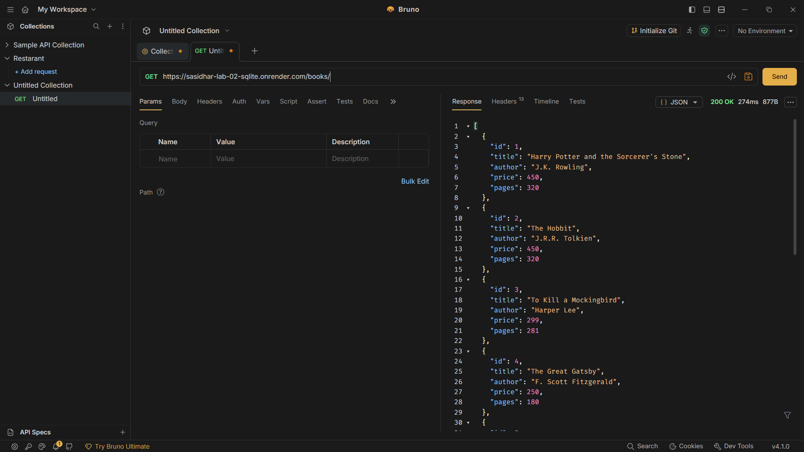
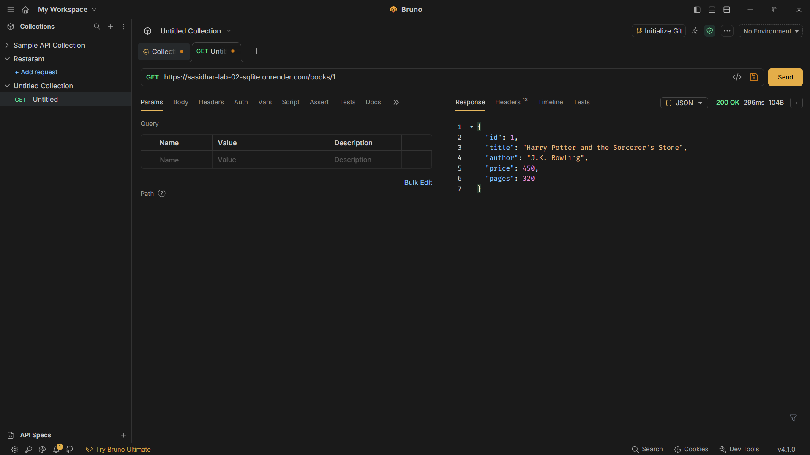
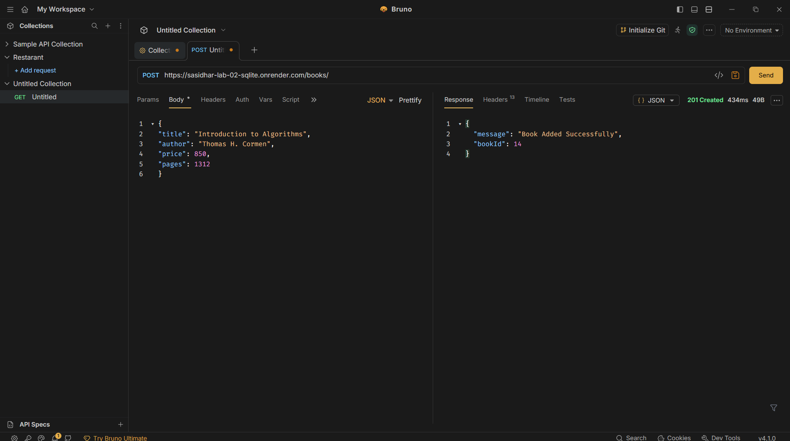
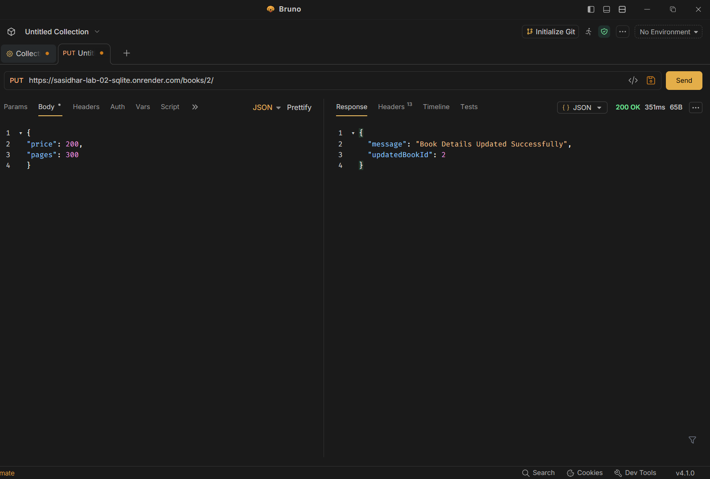
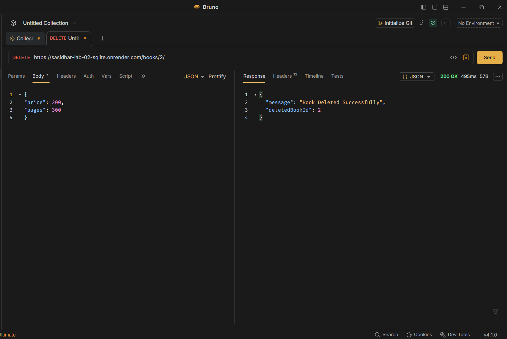
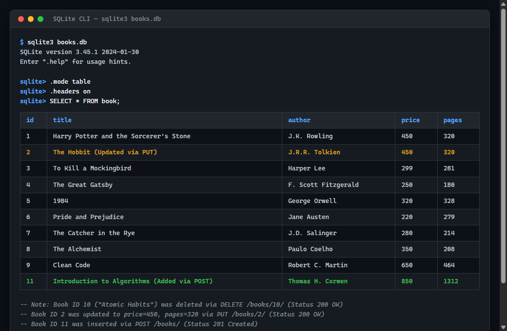

# Lab 2: SQLite database and CRUD routes

**Sasidhar Reddy** · **Registration Number: [Your Registration Number]** · **Section: AIDE-313-2B** · **Faculty: Yugandhar Gurjalwar**

---

### Live Link
- **Deployment URL**: [https://sasidhar-lab-02-sqlite.onrender.com](https://sasidhar-lab-02-sqlite.onrender.com)
> **Note**: For local evaluation, the server runs at `http://localhost:3000`. Detailed steps to run with `nodemon` or standard `node` are provided below.

---

## Table of Contents
1. [Project Overview](#project-overview)
2. [How to Run](#how-to-run)
   - [Prerequisites](#prerequisites)
   - [Installation](#installation)
   - [Environment Variables](#environment-variables)
   - [Starting the Server](#starting-the-server)
3. [Endpoints / CRUD Routes Table](#endpoints--crud-routes-table)
4. [Screenshots of Working Output](#screenshots-of-working-output)
5. [Task Walkthrough & Implementation Details](#task-walkthrough--implementation-details)
   - [Task 1: Package Installation & Nodemon Execution](#task-1-package-installation--nodemon-execution)
   - [Task 2: Database Schema & CLI Seeding](#task-2-database-schema--cli-seeding)
   - [Task 3: Async initializeDBAndServer() Pattern](#task-3-async-initializedbandserver-pattern)
   - [Task 4 & 5: CRUD Routes with Parameterized SQL Queries](#task-4--5-crud-routes-with-parameterized-sql-queries)
   - [Task 6: Postman Testing & SQLite CLI Verification](#task-6-postman-testing--sqlite-cli-verification)
6. [Viva Questions & Model Answers](#viva-questions--model-answers)
7. [Notes: Problems Faced and How You Solved Them](#notes-problems-faced-and-how-you-solved-them)

---

## Project Overview
This project satisfies all requirements for **Lab 2: SQLite database and CRUD routes** in *Backend Development Fundamentals* (Year II Term II · Aurora). The application establishes a persistent connection between an Express.js server and a local SQLite relational database (`books.db`), providing full **CRUD** (Create, Read, Update, Delete) capabilities over HTTP using asynchronous database operations and parameterized queries (`?` placeholders) to guard against SQL injection vulnerabilities.

---

## How to Run

### Prerequisites
- **Node.js**: `v18.x` or higher (verified on `v22.23.1`)
- **npm**: `v9.x` or higher (verified on `v10.9.8`)

### Installation
Clone the repository and navigate into the `lab-02` directory:
```bash
git clone https://github.com/sasi9603-hack/BACKEND_AIDE_SASIDHARREDDY.git
cd BACKEND_AIDE_SASIDHARREDDY/lab-02
npm install
```

### Environment Variables
Optionally configure a `.env` file in the root of `lab-02/`:
```env
# Server Port (Defaults to 3000 if not specified)
PORT=3000

# Node Environment
NODE_ENV=development
```
*(Note: As per course rules, `.env` and `node_modules` are strictly excluded from version control via `.gitignore`).*

### Starting the Server

#### 1. Development Mode (with Nodemon - Task 1):
```bash
npm run dev
```
Nodemon monitors for file modifications and automatically restarts the server.

#### 2. Standard Production Mode:
```bash
npm start
```

#### 3. Database Re-seeding (Optional):
```bash
node setup-db.js
```
The server will be accessible at: `http://localhost:3000`

---

## Endpoints / CRUD Routes Table

| HTTP Method | Route Path | Operation | Description | Request Body | Status Code | Live Test Link |
| :--- | :--- | :---: | :--- | :--- | :---: | :--- |
| `GET` | `/` | **Health / Info** | API Welcome & endpoints overview | None | `200 OK` | [Live Link](https://sasidhar-lab-02-sqlite.onrender.com/) |
| `GET` | `/books/` | **Read (All)** | Returns an array of all books ordered by ID | None | `200 OK` | [Live Link](https://sasidhar-lab-02-sqlite.onrender.com/books/) |
| `GET` | `/books/:bookId/` | **Read (One)** | Returns single book details matching `bookId` | None | `200 OK` / `404` | [Live Link (ID: 1)](https://sasidhar-lab-02-sqlite.onrender.com/books/1/) |
| `POST` | `/books/` | **Create** | Inserts a new book record into the database | JSON `{ title, author, price, pages }` | `201 Created` | *(Use Postman / curl)* |
| `PUT` | `/books/:bookId/` | **Update** | Modifies fields of an existing book by `bookId` | JSON `{ title, author, price, pages }` | `200 OK` / `404` | *(Use Postman / curl)* |
| `DELETE` | `/books/:bookId/` | **Delete** | Removes a book record from database by `bookId` | None | `200 OK` / `404` | *(Use Postman / curl)* |

> **Note on Testing POST, PUT, and DELETE**:
> Web browser hyperlinks only perform HTTP `GET` requests. To test mutating operations (`POST`, `PUT`, `DELETE`) on the local or live Render deployment, use **Bruno** (see [Screenshots](#screenshots-of-working-output)) or copy the terminal commands below:
> 
> ```bash
> # 1. Create a Book (POST)
> curl -X POST https://sasidhar-lab-02-sqlite.onrender.com/books/ \
>   -H "Content-Type: application/json" \
>   -d '{"title": "Clean Code", "author": "Robert C. Martin", "price": 650, "pages": 464}'
>
> # 2. Update a Book (PUT)
> curl -X PUT https://sasidhar-lab-02-sqlite.onrender.com/books/1/ \
>   -H "Content-Type: application/json" \
>   -d '{"price": 499}'
>
> # 3. Delete a Book (DELETE)
> curl -X DELETE https://sasidhar-lab-02-sqlite.onrender.com/books/1/
> ```

---

## Screenshots of Working Output

### 1. GET /books/ (Read All Books)
Fetches the full collection of book records from the SQLite database.


### 2. GET /books/:bookId/ (Read Single Book)
Retrieves a specific book by ID (`GET /books/1/`).


### 3. POST /books/ (Create / Add Book)
Inserts a new book into the database (`201 Created`) returning the auto-generated `bookId`.


### 4. PUT /books/:bookId/ (Update Book)
Modifies existing book attributes (`PUT /books/2/`) updating price and pages.


### 5. DELETE /books/:bookId/ (Delete Book)
Removes a book record (`DELETE /books/2/`) from the database.


### 6. SQLite CLI Verification
Direct CLI query output (`SELECT * FROM book;`) confirming database state changes after POST, PUT, and DELETE.


---

## Task Walkthrough & Implementation Details

### Task 1: Package Installation & Nodemon Execution
The project uses `express`, `sqlite`, `sqlite3` for production database operations and `nodemon` for development hot-reloading:
```bash
npm install express sqlite sqlite3
npm install -D nodemon
```
Nodemon is configured in `package.json`:
```json
"scripts": {
  "start": "node app.js",
  "dev": "nodemon app.js"
}
```

### Task 2: Database Schema & CLI Seeding
The database table `book` is created with the following relational schema:
```sql
CREATE TABLE IF NOT EXISTS book (
    id INTEGER PRIMARY KEY AUTOINCREMENT,
    title TEXT NOT NULL,
    author TEXT NOT NULL,
    price INTEGER NOT NULL,
    pages INTEGER NOT NULL
);
```
10 initial rows are seeded into `books.db` using parameterized statements:
```sql
INSERT INTO book (title, author, price, pages) VALUES (?, ?, ?, ?);
```

### Task 3: Async `initializeDBAndServer()` Pattern
The server ensures the SQLite database connection is established **before** listening for HTTP requests, preventing incoming queries against uninitialized database handles:
```javascript
const initializeDBAndServer = async () => {
    try {
        db = await open({
            filename: dbPath,
            driver: sqlite3.Database,
        });
        const PORT = process.env.PORT || 3000;
        app.listen(PORT, () => {
            console.log(`Server Running at http://localhost:${PORT}/`);
        });
    } catch (e) {
        console.error(`DB Error: ${e.message}`);
        process.exit(1);
    }
};

initializeDBAndServer();
```

### Task 4 & 5: CRUD Routes with Parameterized SQL Queries
Every user-provided input (`bookId`, `title`, `author`, `price`, `pages`) is supplied as parameterized values using `?` placeholders:

```javascript
// GET all books
app.get("/books/", async (request, response) => {
    const getBooksQuery = `SELECT * FROM book ORDER BY id;`;
    const booksArray = await db.all(getBooksQuery);
    response.status(200).json(booksArray);
});

// GET single book
app.get("/books/:bookId/", async (request, response) => {
    const { bookId } = request.params;
    const getBookQuery = `SELECT * FROM book WHERE id = ?;`;
    const book = await db.get(getBookQuery, [bookId]);
    if (!book) return response.status(404).json({ error: "Book not found" });
    response.status(200).json(book);
});

// POST add new book
app.post("/books/", async (request, response) => {
    const { title, author, price, pages } = request.body;
    const addBookQuery = `
        INSERT INTO book (title, author, price, pages)
        VALUES (?, ?, ?, ?);
    `;
    const dbResponse = await db.run(addBookQuery, [title, author, price, pages]);
    response.status(201).json({ message: "Book Added Successfully", bookId: dbResponse.lastID });
});

// PUT update book
app.put("/books/:bookId/", async (request, response) => {
    const { bookId } = request.params;
    const { title, author, price, pages } = request.body;
    const updateBookQuery = `
        UPDATE book
        SET title = ?, author = ?, price = ?, pages = ?
        WHERE id = ?;
    `;
    await db.run(updateBookQuery, [title, author, price, pages, bookId]);
    response.status(200).json({ message: "Book Details Updated Successfully", updatedBookId: Number(bookId) });
});

// DELETE remove book
app.delete("/books/:bookId/", async (request, response) => {
    const { bookId } = request.params;
    const deleteBookQuery = `DELETE FROM book WHERE id = ?;`;
    await db.run(deleteBookQuery, [bookId]);
    response.status(200).json({ message: "Book Deleted Successfully", deletedBookId: Number(bookId) });
});
```


## Notes: Problems Faced and How You Solved Them

1. **Ensuring DB Initialization Precedes Request Routing**:
   - *Problem*: If route handlers accept requests before `open()` resolves, queries fail with `TypeError: Cannot read properties of null (reading 'all')`.
   - *Solution*: Encapsulated database opening and server startup inside `initializeDBAndServer()`, calling `app.listen()` strictly inside the `try` block after `await open()` succeeds.

2. **Handling Missing Resources with Accurate Status Codes**:
   - *Problem*: Attempting to update or delete non-existent IDs without verification can lead to ambiguous client responses.
   - *Solution*: Implemented pre-checks using `SELECT * FROM book WHERE id = ?;` to immediately return `404 Not Found` when a target `bookId` does not exist in the database.

3. **Handling JSON Body Parsing in Express**:
   - *Problem*: `request.body` returned `undefined` during POST and PUT requests.
   - *Solution*: Added `app.use(express.json())` middleware at the top of the Express app to parse JSON incoming request payloads.
