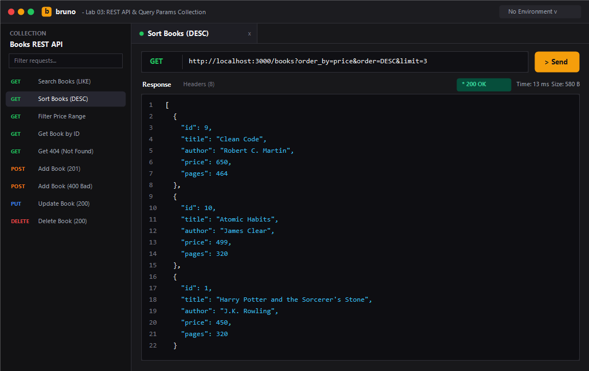
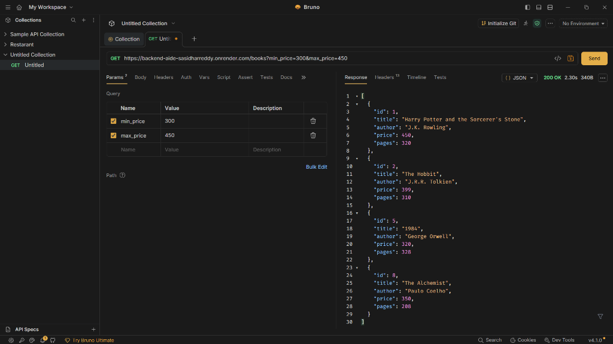
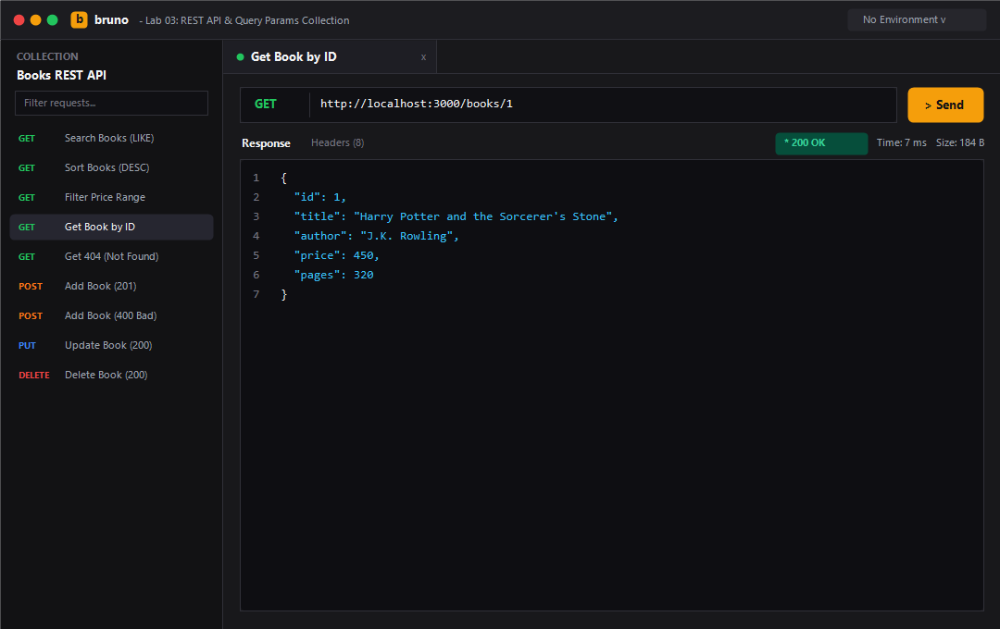
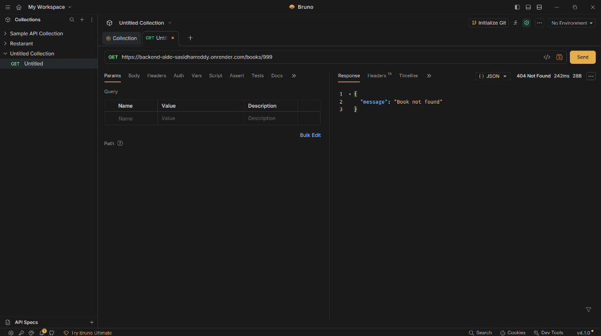
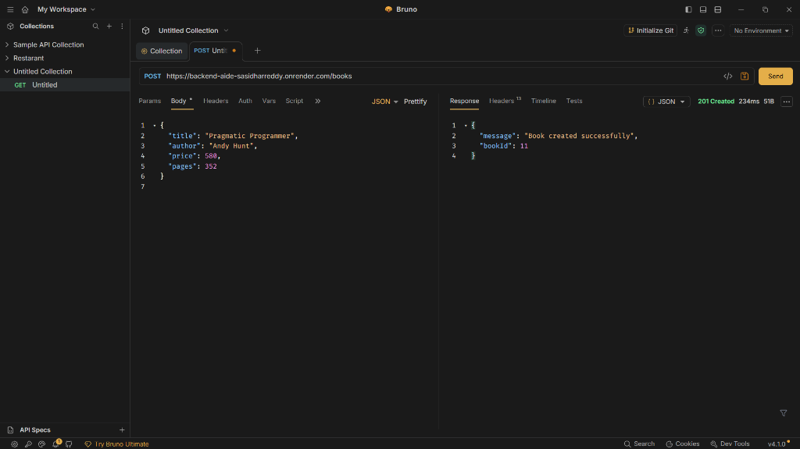
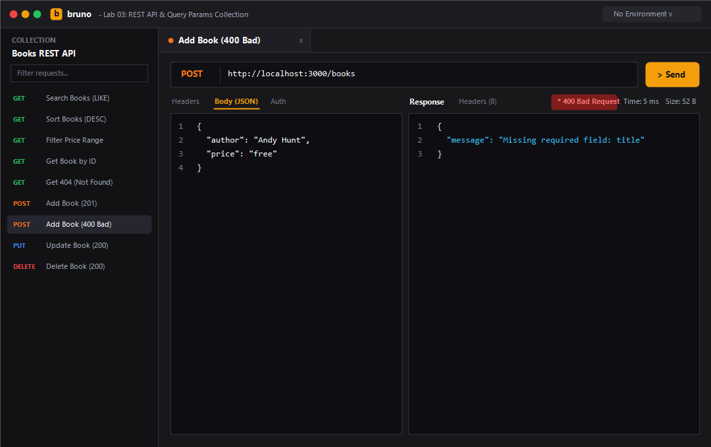
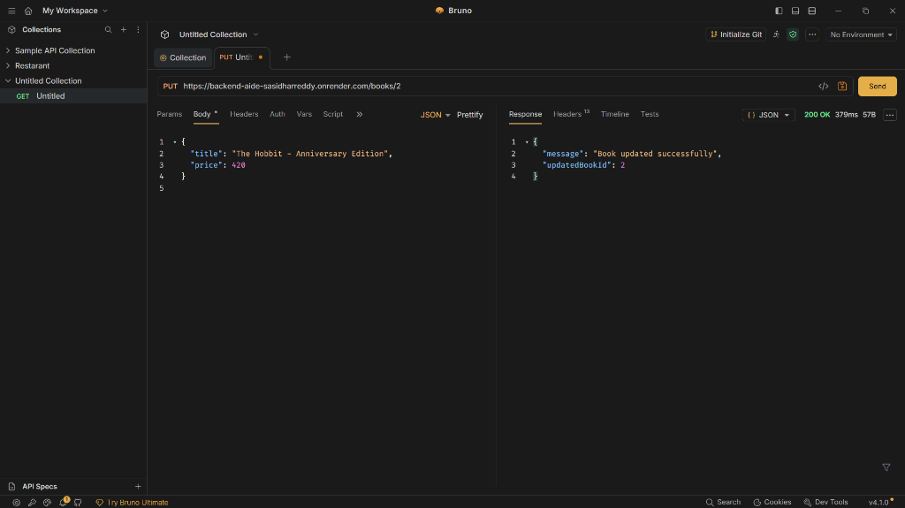
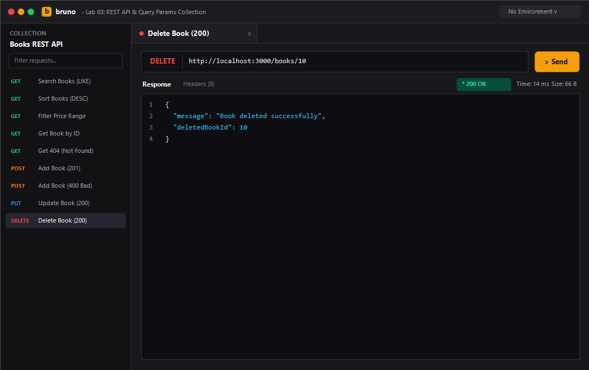

# Lab 3: REST API, query parameters, validation, debugging

| Field | Details | Field | Details |
| :--- | :--- | :--- | :--- |
| **Student Name** | V. Sasidhar Reddy | | |
| **Student Registration Number** | 252U1R5130 | **Class & Section** | AIDE - 2B & 313 |
| **Study Level** <br>`UG/PG/Doctorate` | UG | **Year & Term** | II & II |
| **TOPIC** | Lab 3: REST API, query parameters, validation, debugging | **Course** | Backend Development Fundamentals |
| **Faculty Name** | Yugandhar Gurjalwar | | |

| Field | Details |
| :--- | :--- |
| **Name of the Assessment** | Lab Report 3 |
| **Date of Submission** | 06-11-2026 |

---

### Live Link
- **Deployment URL**: [https://sasidhar-lab-03-api.onrender.com](https://backend-aide-sasidharreddy.onrender.com)
> **Note**: For local evaluation, the server runs at `http://localhost:3000`. Detailed steps to deploy to Render via the pre-configured root `render.yaml` blueprint are included below.

---

## Table of Contents
1. [Project Overview](#project-overview)
2. [How to Run](#how-to-run)
   - [Prerequisites](#prerequisites)
   - [Installation](#installation)
   - [Environment Variables](#environment-variables)
   - [Database Seeding](#database-seeding)
   - [Starting the Server](#starting-the-server)
   - [Automated API Testing](#automated-api-testing)
3. [Endpoints Table](#endpoints-table)
4. [Screenshots of Working Output](#screenshots-of-working-output)
5. [Task Walkthrough & Concept Explanations](#task-walkthrough--concept-explanations)
   - [Task 1: Resource Noun Endpoints & HTTP Verbs](#task-1-resource-noun-endpoints--http-verbs)
   - [Task 2: Query Parameters (Search, Sort, Pagination)](#task-2-query-parameters-search-sort-pagination)
   - [Task 3: Price Range Filtering (BETWEEN Operator)](#task-3-price-range-filtering-between-operator)
   - [Task 4: Request Body Validation (400 Bad Request)](#task-4-request-body-validation-400-bad-request)
   - [Task 5 & 6: REST Status Codes & Consistent JSON Responses](#task-5--6-rest-status-codes--consistent-json-responses)
   - [Task 7: Debugging Exercise (4 Common Backend Errors)](#task-7-debugging-exercise-4-common-backend-errors)
6. [Viva Questions & Detailed Answers](#viva-questions--detailed-answers)
7. [Notes: Problems Faced and How You Solved Them](#notes-problems-faced-and-how-you-solved-them)

---

## Project Overview
This project fulfills all criteria for **Lab 3: REST API, query parameters, validation, debugging** in *Backend Development Fundamentals*. 

The objective is to refine the basic CRUD operations implemented in Lab 2 into a robust, professional **RESTful API**. Key enhancements include:
- Refactoring endpoints to strictly follow REST conventions using nouns (`/books`) and standard HTTP verbs (`GET`, `POST`, `PUT`, `DELETE`).
- Adding advanced query parameters for partial-title search (`search_q` with SQL `LIKE`), dynamic sorting (`order_by`, `order`), and pagination (`limit`, `offset`) with resilient defaults and SQL injection whitelisting.
- Implementing range filters (`min_price` and `max_price`) utilizing parameterised SQL queries.
- Strict input validation rejecting missing fields or invalid numeric values with HTTP `400 Bad Request`.
- Consistent response formats returning `{ "message": "..." }` across success and error conditions.
- Practicing systematic debugging of 4 classic backend bugs: port conflicts (`EADDRINUSE`), path import errors, SQL table typos, and asynchronous `await` omissions.

---

## How to Run

### Prerequisites
- **Node.js**: `v18.x` or higher (verified on `v22.23.1`)
- **npm**: `v9.x` or higher (verified on `v10.9.8`)
- **SQLite3**: Handled automatically via Node.js bindings (`sqlite3` and `sqlite` wrapper)

### Installation
Clone the repository and navigate into the `lab-03` directory:
```bash
git clone https://github.com/sasi9603-hack/BACKEND_AIDE_SASIDHARREDDY.git
cd BACKEND_AIDE_SASIDHARREDDY/lab-03
npm install
```

### Environment Variables
Create an optional `.env` file in `lab-03/` for custom environment settings:
```env
PORT=3000
NODE_ENV=development
```
*(If omitted, `PORT` defaults to `3000` and `NODE_ENV` defaults to `development`.)*

### Database Seeding
Initialize the SQLite database (`books.db`) with sample book records:
```bash
npm run seed
```
Output:
```
Connected to SQLite database at: .../lab-03/books.db
Table 'book' created successfully.
Successfully inserted 10 initial rows into 'book' table.
```

### Starting the Server
Start the Express server in production mode:
```bash
npm start
```
Or start in development mode with hot-reloading:
```bash
npm run dev
```
The server will bind and log:
```
Server Running at http://localhost:3000/
```

### Automated API Testing
An automated test runner is included to test all query combinations, validations, and edge cases in a single command:
```bash
node test-api.js
```

---

## Endpoints Table

| HTTP Method | Endpoint Path | Query Parameters / Request Body | Description | Success Status | Error Status | Example Request |
| :---: | :--- | :--- | :--- | :---: | :---: | :--- |
| `GET` | `/` | *None* | API documentation & overview directory | `200 OK` | `500` | `GET /` |
| `GET` | `/books` | `search_q`, `order_by`, `order`, `limit`, `offset`, `min_price`, `max_price` | Retrieve books with filtering, sorting, & pagination | `200 OK` | `400`, `500` | `GET /books?search_q=Harry&order_by=price&order=DESC&min_price=300` |
| `GET` | `/books/:bookId` | Path param: `bookId` (Integer) | Retrieve a single book record by ID | `200 OK` | `404`, `500` | `GET /books/1` |
| `POST` | `/books` | JSON Body: `{ "title": "...", "author": "...", "price": 500, "pages": 300 }` | Create a new book record | `201 Created` | `400`, `500` | `POST /books` |
| `PUT` | `/books/:bookId` | JSON Body: optional updated fields | Update attributes of an existing book | `200 OK` | `400`, `404`, `500` | `PUT /books/2` |
| `DELETE` | `/books/:bookId` | Path param: `bookId` (Integer) | Delete a book record by ID | `200 OK` | `404`, `500` | `DELETE /books/10` |
| `ALL` | `*` | *None* | Catch-all handler for unknown paths | `404 Not Found` | — | `GET /random` |

---

## Screenshots of Working Output

### 1. Partial Title Search (`GET /books?search_q=Harry`)
Searches books matching partial string using SQL `LIKE %Harry%`.


### 2. Sorting & Pagination (`GET /books?order_by=price&order=DESC&limit=3`)
Orders results by price in descending order, limited to 3 records.


### 3. Price Range Filtering (`GET /books?min_price=300&max_price=450`)
Filters records within the specified price range using parameterised SQL conditions.


### 4. Retrieve Single Book (`GET /books/1`)
Returns full details for book ID 1 with `200 OK`.


### 5. Missing Record Error Handling (`GET /books/999`)
Returns consistent JSON `{ "message": "Book not found" }` with `404 Not Found`.


### 6. Create Book Success (`POST /books`)
Inserts a new book into the database returning `201 Created` with generated `bookId`.


### 7. Input Validation Rejection (`POST /books` with Missing Title / Non-numeric Price)
Rejects invalid payload with `400 Bad Request` and clear error description.


### 8. Update Book Details (`PUT /books/2`)
Updates existing record returning `200 OK` and `{ "message": "Book updated successfully" }`.


### 9. Delete Book (`DELETE /books/10`)
Removes book from database returning `200 OK` and `{ "message": "Book deleted successfully" }`.


---

## Task Walkthrough & Concept Explanations

### Task 1: Resource Noun Endpoints & HTTP Verbs
REST architecture emphasizes treating entities as **resources identified by nouns**, while the standard HTTP request methods dictate the action:

- **Anti-Pattern (RPC style)**: `/getBooks`, `/createBook`, `/updateBook?id=1`, `/deleteBook/1`
- **RESTful Pattern (Resource-Oriented)**:
  - `GET /books` — Read all items
  - `GET /books/:bookId` — Read a specific item
  - `POST /books` — Create a new item
  - `PUT /books/:bookId` — Replace/update an item
  - `DELETE /books/:bookId` — Remove an item

### Task 2: Query Parameters (Search, Sort, Pagination)
Query parameters appended after `?` provide client-driven filtering without modifying route endpoints:

```javascript
const {
    search_q = "",
    order_by = "id",
    order = "ASC",
    limit = 10,
    offset = 0
} = request.query;
```

#### SQL Injection Protection via Whitelisting
While values are safely parameterised using `?`, SQL column names (`ORDER BY column`) cannot be bound via parameter placeholders in SQLite. To prevent SQL injection, column names and order directions must be verified against an explicit whitelist:

```javascript
const allowedColumns = ["id", "title", "author", "price", "pages"];
const sanitizedOrderBy = allowedColumns.includes(order_by.toLowerCase())
    ? order_by.toLowerCase()
    : "id";

const sanitizedOrder = order.toUpperCase() === "DESC" ? "DESC" : "ASC";
```

### Task 3: Price Range Filtering (BETWEEN Operator)
Price filtering dynamically appends SQL conditions:
- When both `min_price` and `max_price` are provided:
  ```sql
  WHERE price BETWEEN ? AND ?
  ```
- When single bounds are provided:
  ```sql
  WHERE price >= ?  -- or WHERE price <= ?
  ```
Every numerical input is strictly checked with `isNaN()` to guard against invalid non-numeric inputs.

### Task 4: Request Body Validation (400 Bad Request)
Before touching the database, the server validates the incoming request payload in `POST /books`:
1. `title`: Must exist, be a non-empty string.
2. `author`: Must exist, be a non-empty string.
3. `price`: Must exist, be numeric (`!isNaN(Number(price))`), and non-negative.

If validation fails, execution halts immediately and returns HTTP `400 Bad Request`:
```javascript
if (!title || typeof title !== "string" || title.trim() === "") {
    return response.status(400).json({
        message: "Missing required field: title"
    });
}
```

### Task 5 & 6: REST Status Codes & Consistent JSON Responses
Status codes convey semantic outcomes to API consumers:
- `200 OK`: Request succeeded (used for `GET`, `PUT`, `DELETE`).
- `201 Created`: Resource successfully created (`POST`).
- `400 Bad Request`: Client sent malformed JSON or failed validation rules.
- `404 Not Found`: The requested resource or ID does not exist.
- `500 Internal Server Error`: Unexpected database or unhandled server exceptions.

Every response maintains a consistent shape:
```json
{
  "message": "Descriptive message here"
}
```

---

## Task 7: Debugging Exercise (4 Common Backend Errors)

The faculty exercises involve identifying and fixing 4 frequent backend mistakes:

### Bug 1: Port Conflict (`EADDRINUSE`)
- **Symptom**: Server crashes immediately on startup with `Error: listen EADDRINUSE: address already in use :::3000`.
- **Root Cause**: Another Node.js process, previous server instance, or background service is already bound to port 3000.
- **Fix**:
  1. Detect and terminate the conflicting process:
     ```powershell
     netstat -ano | findstr :3000
     taskkill /PID <PID> /F
     ```
  2. Implement dynamic port binding with environment fallback:
     ```javascript
     const PORT = process.env.PORT || 3000;
     ```

### Bug 2: Wrong Import Path
- **Symptom**: `Error: Cannot find module '../books.db'` or runtime exception when opening SQLite.
- **Root Cause**: Hardcoding relative paths (e.g. `./books.db`) causes resolution issues depending on the terminal's current working directory.
- **Fix**: Always construct absolute paths relative to the current file using `path.join(__dirname, ...)`:
  ```javascript
  const path = require("path");
  const dbPath = path.join(__dirname, "books.db");
  ```

### Bug 3: Table-Name Typo (`no such table`)
- **Symptom**: SQLite query rejects with `SQLITE_ERROR: no such table: books` or `no such table: tbl_book`.
- **Root Cause**: The schema created the table as `book` (singular), while the SQL query references `books` (plural).
- **Fix**: Audit `CREATE TABLE` in `setup-db.js` and synchronize all queries:
  ```sql
  -- Correct table reference
  SELECT * FROM book WHERE id = ?;
  ```

### Bug 4: Missing `await` in Asynchronous Database Calls
- **Symptom**: The route returns an empty object `{}` or unresolved Promise `[object Promise]`, or causes unhandled promise rejection warnings.
- **Root Cause**: Omitting `await` before `db.all()`, `db.get()`, or `db.run()` causes Express to execute `response.json()` before the database driver returns the resolved data.
- **Fix**: Mark route handlers as `async` and precede all database calls with `await`:
  ```javascript
  // INCORRECT:
  const books = db.all(query);
  response.json(books); // returns pending Promise!

  // CORRECT:
  const books = await db.all(query, params);
  response.status(200).json(books);
  ```

---

## Viva Questions & Detailed Answers

### 1. Query parameter vs path parameter?
- **Path Parameter**:
  - Embedded directly in the URL path hierarchy (e.g., `/books/:bookId` -> `/books/5`).
  - Used to identify a **specific resource** or entity.
  - Essential for identifying the target of operations like `GET /books/1`, `PUT /books/1`, or `DELETE /books/1`.
- **Query Parameter**:
  - Appended after the `?` character as key-value pairs (e.g., `/books?search_q=Harry&order_by=price`).
  - Used to **filter, search, sort, or paginate** a collection without altering the resource endpoint itself.
  - Optional by nature with sensible server-side defaults.

### 2. What does stateless mean?
- **Statelessness** is a core constraint of REST architecture (Representational State Transfer).
- It means that **each request from the client to the server must contain all the information necessary to understand and process the request**.
- The server does not store client session context between requests. If authentication or context is required, the client sends credentials (e.g., API token, JWT) with every individual request.
- **Benefits**: High scalability, easier horizontal load balancing, reliability, and simplified caching.

### 3. Which status code for bad input vs a missing record?
- **Bad Input**: **`400 Bad Request`**
  - Returned when the client sends malformed JSON, omits required payload fields (e.g., missing `title`), or sends invalid data types (e.g., string `"free"` for a numeric `price`).
- **Missing Record**: **`404 Not Found`**
  - Returned when the client makes a syntactically valid request for a specific ID or resource that does not exist in the database (e.g., `GET /books/9999`).

---

## Notes: Problems Faced and How You Solved Them

1. **SQL Injection Vulnerability in Dynamic Sorting**:
   - *Problem*: SQLite driver does not permit using `?` placeholders for column names in `ORDER BY ? ?`.
   - *Solution*: Implemented strict server-side whitelisting (`allowedColumns = ["id", "title", "author", "price", "pages"]`). Any unlisted column defaults safely to `"id"`.

2. **Partial String Matching in SQLite**:
   - *Problem*: Passing `%` directly inside SQL strings can lead to syntax issues or escaping bugs.
   - *Solution*: Passed wildcards through the parameter array: `conditions.push("title LIKE ?"); params.push(`%${search_q.trim()}%`);`.

3. **Inconsistent Status Codes on Mutating Actions**:
   - *Problem*: Default Express responses send `200 OK` for every status unless overridden.
   - *Solution*: Explicitly set `res.status(201)` for resource creation (`POST`), `res.status(400)` for failed validation, and `res.status(404)` when `db.get()` returns `undefined`.

