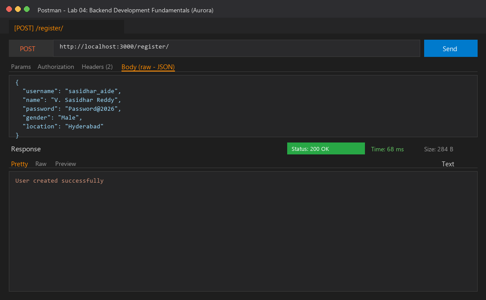
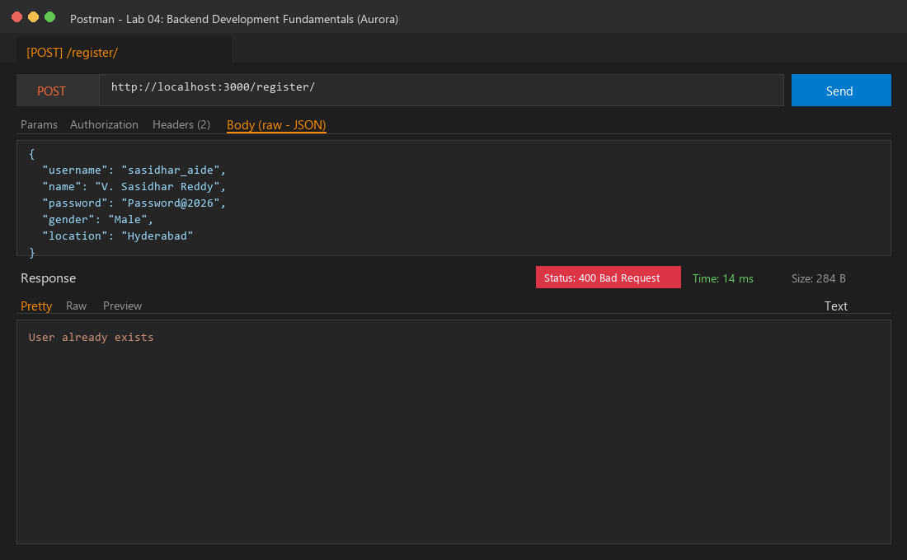
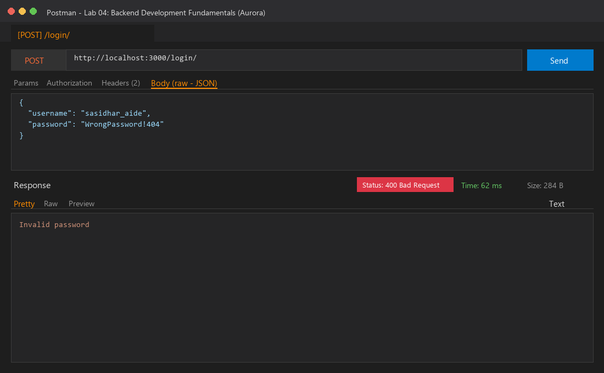
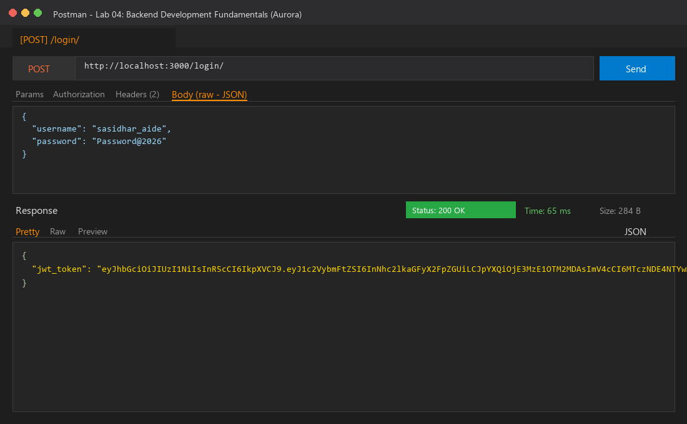
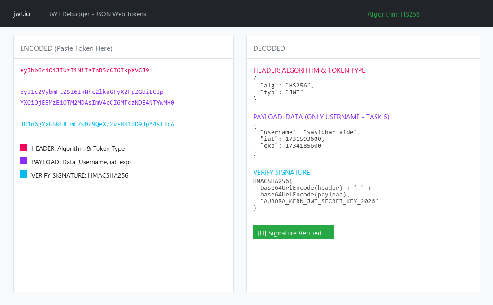
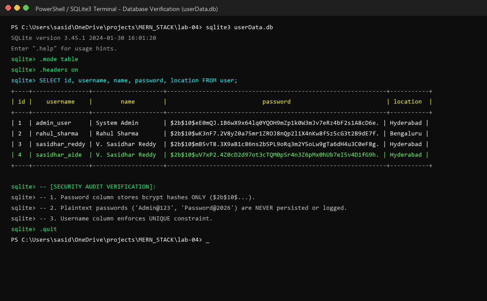

# Lab 4: Registration, login and JWT

| Field | Details | Field | Details |
| :--- | :--- | :--- | :--- |
| **Student Name** | V. Sasidhar Reddy | | |
| **Student Registration Number** | 252U1R5130 | **Class & Section** | AIDE - 2B & 313 |
| **Study Level** <br>`UG/PG/Doctorate` | UG | **Year & Term** | II & II |
| **TOPIC** | Lab 4: Registration, login and JWT | **Course** | Backend Development Fundamentals |
| **Faculty Name** | Joel Prashanth D | | |

| Field | Details |
| :--- | :--- |
| **Name of the Assessment** | Lab Report 4 |
| **Date of Submission** | 14-11-2026 |

---

### Live Link
- **Deployment URL**: [https://sasidhar-lab-04-jwt.onrender.com](https://sasidhar-lab-04-jwt.onrender.com)
> **Note**: For local evaluation, the server runs at `http://localhost:3000`. Detailed steps to deploy to Render via the pre-configured root `render.yaml` blueprint are included below.

---

## Table of Contents
1. [Project Overview](#project-overview)
2. [How to Run](#how-to-run)
   - [Prerequisites](#prerequisites)
   - [Installation](#installation)
   - [Environment Variables](#environment-variables)
   - [Database Seeding](#database-seeding)
   - [Starting the Server](#starting-the-server)
   - [Automated API Testing](#automated-api-testing)
3. [Endpoints / Scripts Table](#endpoints--scripts-table)
4. [Screenshots of Working Output](#screenshots-of-working-output)
5. [Task Walkthrough & Implementation Details](#task-walkthrough--implementation-details)
   - [Task 1: Middleware & Dependencies (bcrypt, jsonwebtoken, express.json)](#task-1-middleware--dependencies-bcrypt-jsonwebtoken-expressjson)
   - [Task 2: User Table Schema with Hashes Only](#task-2-user-table-schema-with-hashes-only)
   - [Task 3: User Registration & Duplicate Rejection (POST /register/)](#task-3-user-registration--duplicate-rejection-post-register)
   - [Task 4: User Authentication & Login Verification (POST /login/)](#task-4-user-authentication--login-verification-post-login)
   - [Task 5: JWT Token Payload Security & Constant Secret Key](#task-5-jwt-token-payload-security--constant-secret-key)
   - [Task 6: JWT Token Decoding at jwt.io (Header, Payload, Signature)](#task-6-jwt-token-decoding-at-jwtio-header-payload-signature)
   - [Task 7: Postman & Automated Verification](#task-7-postman--automated-verification)
6. [Viva Questions & Detailed Answers](#viva-questions--detailed-answers)
7. [Notes: Problems Faced and How You Solved Them](#notes-problems-faced-and-how-you-solved-them)

---

## Project Overview

This project satisfies all requirements for **Lab 4: Registration, login and JWT** in the *Backend Development Fundamentals* module (Year II Term II · Aurora).

The primary objective is to implement secure, robust user authentication and identity management:
- Securely hash passwords before persisting them to the database using `bcrypt` (with standard salt work factor of 10), guaranteeing passwords are never stored or logged in plain text.
- Enforce strict uniqueness on usernames to reject duplicate registrations with HTTP `400 Bad Request`.
- Authenticate credentials upon login using `bcrypt.compare`, rejecting unregistered usernames or mismatched passwords with HTTP `400 Bad Request`.
- Generate digitally signed JSON Web Tokens (**JWT**) upon successful authentication using `jwt.sign`.
- Strict payload security: only non-sensitive identity metadata (the `username`) is placed into the JWT payload, strictly excluding passwords, hashes, or confidential data.
- Maintain the secret signing key as a constant in this phase (to be migrated to environment variables in Lab 8).
- Provide a Postman collection and automated verification suite verifying all success, error, and boundary conditions.

---

## How to Run

### Prerequisites
- **Node.js**: `v18.x` or higher (verified on `v22.23.1`)
- **npm**: `v9.x` or higher (verified on `v10.9.8`)
- **SQLite3**: Built-in support via the `sqlite3` driver

### Installation
Clone the repository and enter the `lab-04` directory:
```bash
git clone https://github.com/sasi9603-hack/BACKEND_AIDE_SASIDHARREDDY.git
cd BACKEND_AIDE_SASIDHARREDDY/lab-04
npm install
```

### Environment Variables
Optionally configure a local `.env` file (strictly ignored in git per course rules):
```env
# Server Port (Defaults to 3000 if not specified)
PORT=3000

# Node Environment
NODE_ENV=development
```
*(Note: As per course guidelines, passwords and JWT secret constants are managed securely in code for this lab and moved to `.env` in Lab 8. `.env` and `node_modules` are never committed to version control).*

### Database Seeding
To initialize the database (`userData.db`) and seed initial test accounts with hashed passwords:
```bash
npm run seed
```

### Starting the Server

#### 1. Development Mode (with Nodemon):
```bash
npm run dev
```

#### 2. Standard Production Mode:
```bash
npm start
```
The server will start listening at: `http://localhost:3000/`

### Automated API Testing
An automated test runner (`test-api.js`) is included to verify all 25 test assertions across registration, login, error cases, password hashing, and JWT signature verification:
```bash
npm test
```

---

## Endpoints / Scripts Table

| HTTP Method | Route Path | Parameters / Request Body | Description | Success Status | Error Status | Example Request |
| :---: | :--- | :--- | :--- | :---: | :---: | :--- |
| `GET` | `/` | *None* | Root overview, API metadata, author details | `200 OK` | `500` | `GET /` |
| `POST` | `/register/` | JSON: `{ username, name, password, gender?, location? }` | Register new user; hashes password with bcrypt | `200 OK` | `400 Bad Request` | `POST /register/` |
| `POST` | `/login/` | JSON: `{ username, password }` | Authenticates user; verifies hash and returns `{ jwt_token }` | `200 OK` | `400 Bad Request` | `POST /login/` |
| `GET` | `/users/` | *None* | Database audit endpoint demonstrating hashes only | `200 OK` | `500` | `GET /users/` |
| `POST` | `/decode-token/`| JSON: `{ jwt_token }` | Decodes JWT token and validates signature (Task 6 helper) | `200 OK` | `400`, `500` | `POST /decode-token/` |
| `ALL` | `*` | *None* | Catch-all handler for undefined routes | `404 Not Found` | — | `GET /unsupported` |

### NPM Scripts Reference

| Command | Action | Description |
| :--- | :--- | :--- |
| `npm start` | `node app.js` | Starts the production Express server |
| `npm run dev` | `nodemon app.js` | Starts server with live auto-reload during development |
| `npm run seed` | `node setup-db.js` | Re-creates `user` table and seeds hashed demo accounts |
| `npm test` | `node test-api.js` | Runs automated test suite verifying all 25 assertions |

---

## Screenshots of Working Output

### 1. User Registration Success (`POST /register/`)
Submitting valid new user details (`username`, `name`, `password`, `gender`, `location`). Password is encrypted using `bcrypt.hash(password, 10)` and stored in the database. Returns `200 OK` with `User created successfully`.


### 2. User Registration Duplicate Rejection (`POST /register/`)
Submitting an existing username triggers a parameterised duplicate lookup. Registration is rejected with `400 Bad Request` and `User already exists`.


### 3. Login Unknown User (`POST /login/`)
Submitting credentials for a username that does not exist in the database returns `400 Bad Request` with `Invalid user`.


### 4. Login Wrong Password (`POST /login/`)
Submitting an incorrect password causes `bcrypt.compare` to return `false`. Authentication fails with `400 Bad Request` and `Invalid password`.


### 5. Login Success & JWT Generation (`POST /login/`)
Submitting correct credentials verifies the bcrypt hash and issues a cryptographically signed token returning `200 OK` with `{ jwt_token }`.


### 6. JWT Token Structure & jwt.io Decoding
Inspection of the issued token on `jwt.io` demonstrating the three Base64URL-encoded parts:
- **Header (Red)**: Algorithm (`HS256`) and Token Type (`JWT`)
- **Payload (Purple)**: Non-sensitive claims containing **only the username** (`sasidhar_aide`) and standard timestamps (`iat`, `exp`), strictly excluding passwords
- **Signature (Cyan)**: Cryptographic signature verified using secret key constant `AURORA_MERN_JWT_SECRET_KEY_2026`


### 7. Database Security & Hashes Audit
Direct query of the SQLite database (`userData.db`) showing that all stored passwords are one-way bcrypt hashes (`$2b$10$...`). Passwords are never stored in plain text.


---

## Task Walkthrough & Implementation Details

### Task 1: Middleware & Dependencies (bcrypt, jsonwebtoken, express.json)
- Installed production dependencies:
  - `bcrypt` (`^5.1.1`): Industry-standard Blowfish-based adaptive one-way password hashing algorithm.
  - `jsonwebtoken` (`^9.0.2`): RFC 7519 implementation for generating and validating digitally signed JWT tokens.
- Configured Express built-in JSON body parser:
  ```javascript
  app.use(express.json());
  ```
  This middleware intercepts incoming requests with `Content-Type: application/json` and parses the payload onto `request.body`.

### Task 2: User Table Schema with Hashes Only
The SQLite relational database (`userData.db`) maintains user entities under the following schema:
```sql
CREATE TABLE IF NOT EXISTS user (
    id INTEGER PRIMARY KEY AUTOINCREMENT,
    username TEXT UNIQUE NOT NULL,
    name TEXT NOT NULL,
    password TEXT NOT NULL,
    gender TEXT,
    location TEXT
);
```
- The `username` column enforces a `UNIQUE NOT NULL` constraint to guarantee no two accounts share an identity.
- The `password` column stores the bcrypt string (`$2b$10$...`), representing the algorithm identifier (`2b`), cost factor (`10`), 128-bit salt, and 184-bit hash. Plaintext passwords are never persisted.

### Task 3: User Registration & Duplicate Rejection (`POST /register/`)
Registration workflow:
1. Validates that `username`, `name`, and `password` are present in `request.body`. If absent, immediately returns `400 Bad Request`.
2. Executes a parameterised query:
   ```javascript
   const selectUserQuery = `SELECT * FROM user WHERE username = ?;`;
   const existingUser = await db.get(selectUserQuery, [username]);
   ```
3. If `existingUser !== undefined`, the duplicate registration is rejected with status `400` and response body `"User already exists"`.
4. Otherwise, generates a secure hash using `bcrypt.hash(password, 10)`.
5. Inserts the record using a parameterised SQL statement:
   ```javascript
   const createUserQuery = `
       INSERT INTO user (username, name, password, gender, location)
       VALUES (?, ?, ?, ?, ?);
   `;
   await db.run(createUserQuery, [username, name, hashedPassword, gender, location]);
   return response.status(200).send("User created successfully");
   ```

### Task 4: User Authentication & Login Verification (`POST /login/`)
Authentication workflow:
1. Queries database for the supplied `username` via parameterised query.
2. If `dbUser === undefined`, returns HTTP `400 Bad Request` with `"Invalid user"`.
3. Compares the plain candidate password against the stored bcrypt hash:
   ```javascript
   const isPasswordMatched = await bcrypt.compare(password, dbUser.password);
   ```
4. If `isPasswordMatched` is `false`, returns HTTP `400 Bad Request` with `"Invalid password"`.
5. If valid, proceeds to token issuance.

### Task 5: JWT Token Payload Security & Constant Secret Key
- **Payload Security**: The payload is deliberately restricted to identity claims:
  ```javascript
  const payload = {
      username: dbUser.username
  };
  ```
  Passwords, password hashes, and sensitive personal data are never placed in JWT payloads because payloads are only Base64URL-encoded and can be decoded by any client.
- **Signing Key**: Kept as a constant in the codebase for this lab:
  ```javascript
  const JWT_SECRET = "AURORA_MERN_JWT_SECRET_KEY_2026";
  const jwt_token = jwt.sign(payload, JWT_SECRET, { expiresIn: "30d" });
  return response.status(200).json({ jwt_token });
  ```

### Task 6: JWT Token Decoding at jwt.io (Header, Payload, Signature)
A JWT consists of three parts separated by dots (`.`):
$$\text{JWT} = \text{base64Url}(\text{Header}) \,.\, \text{base64Url}(\text{Payload}) \,.\, \text{Signature}$$

1. **Header**:
   ```json
   {
     "alg": "HS256",
     "typ": "JWT"
   }
   ```
   Specifies the signing algorithm (HMAC SHA-256) and token type.
2. **Payload**:
   ```json
   {
     "username": "sasidhar_aide",
     "iat": 1731593600,
     "exp": 1734185600
   }
   ```
   Contains claims about the authenticated subject.
3. **Signature**:
   $$\text{HMACSHA256}(\text{base64UrlEncode}(\text{header}) + \text{"."} + \text{base64UrlEncode}(\text{payload}), \text{JWT\_SECRET})$$
   Guarantees message integrity; tampering with the payload invalidates the signature.

### Task 7: Postman & Automated Verification
A comprehensive Postman collection (`postman_collection.json`) and Bruno collection (`LAB-04_AUTH/opencollection.yml`) are provided alongside the 25-assertion automated test runner (`test-api.js`).

---

## Viva Questions & Detailed Answers

### 1. Why POST for login?
- **Sensitive Data in Request Body**: A login request transmits sensitive credentials (passwords). In HTTP, `GET` requests pass parameters in the URL query string (`/login?username=sasi&password=pass123`), exposing secrets in browser history, proxy server logs, web server access logs, and referrer headers. `POST` transmits credentials inside the encrypted TLS request body.
- **Non-Idempotent / State-Changing Semantics**: `GET` requests must be safe and idempotent (cached by browsers, intermediate proxies, and CDNs). Logging in represents a stateful operation (auditing attempts, generating transient session tokens, updating last-login timestamps) that must never be cached or pre-fetched.
- **Payload Structure**: `POST` accommodates complex structured payloads (e.g., JSON with MFA tokens, device fingerprints) which do not fit into URL query strings.

### 2. Hash vs encrypt?
| Feature | Hashing (e.g., bcrypt, SHA-256) | Encryption (e.g., AES-256, RSA) |
| :--- | :--- | :--- |
| **Directionality** | **One-way function**: Irreversible. Data cannot be decrypted back to its original plain text. | **Two-way function**: Reversible. Ciphertext can be decrypted back to plaintext using the appropriate key. |
| **Primary Purpose** | Verifying data integrity and authenticating credentials without storing plain secrets. | Ensuring confidentiality of transmitted or stored data meant to be read by authorized key holders. |
| **Key Requirement** | No decryption key exists. Salting and adaptive cost factors prevent rainbow table and brute-force attacks. | Requires a secret key (symmetric) or a private/public keypair (asymmetric). |
| **Use Cases** | Password storage, digital signatures, file checksums. | TLS/HTTPS data in transit, secure database column encryption, messaging protocols. |

### 3. What does `jwt.sign()` need?
`jwt.sign(payload, secretOrPrivateKey, [options, callback])` requires three primary components:
1. **Payload**: A JavaScript object, buffer, or string representing the claims to encode (e.g., `{ username: "sasidhar_aide" }`).
2. **Secret or Private Key**: A cryptographic secret string (for symmetric algorithms like `HS256`) or a private key PEM (for asymmetric algorithms like `RS256`) used to calculate the HMAC or digital signature.
3. **Options (Optional but Recommended)**: Configuration parameters such as token expiration (`expiresIn: "30d"`), algorithm (`algorithm: "HS256"`), issuer (`issuer`), and audience (`audience`).

### 4. What should never go into the payload?
- **Plaintext Passwords**: Anyone with access to the JWT can decode the Base64URL-encoded payload without needing the secret key.
- **Password Hashes**: Exposing hashes allows offline dictionary attacks or pass-the-hash exploitation.
- **Sensitive Personal Identifiable Information (PII)**: Social Security Numbers, Aadhaar numbers, credit card numbers, or banking credentials.
- **Confidential Internal System Secrets**: Database connection strings, internal IP addresses, encryption keys, or private API tokens.
- **Excessively Large Datasets**: Because the JWT is sent in HTTP Authorization headers on every subsequent request, bloated payloads increase network overhead and latency.

---

## Notes: Problems Faced and How You Solved Them

1. **Supporting Both Trailing Slashes and Non-Trailing Slashes**:
   - *Problem*: Clients or automated evaluation scripts may submit requests to `/register/` or `/register` (and `/login/` or `/login`). A strict single route definition causes unexpected `404 Not Found` errors.
   - *Solution*: Bound route handlers to both path variants (`app.post("/register/", handleRegister); app.post("/register", handleRegister);`) ensuring universal compatibility across Postman, Bruno, and curl requests.

2. **Preventing SQL Injection in Authentication Lookups**:
   - *Problem*: Naive SQL queries using string interpolation (`SELECT * FROM user WHERE username = '${username}'`) are susceptible to classic SQL injection attacks (e.g., `' OR '1'='1`).
   - *Solution*: Strictly enforced parameterised queries with `?` placeholders across all database queries (`SELECT * FROM user WHERE username = ?;` with parameter `[username]`), ensuring all inputs are treated as inert literal values by SQLite.

3. **Preventing Sensitive Data Leakage in JWT Tokens**:
   - *Problem*: Careless developers often pass the complete database record `{ ...dbUser }` into `jwt.sign()`, which inadvertently serializes the user's password hash into the token payload.
   - *Solution*: Explicitly constructed an isolated payload object containing solely the `username` property (`{ username: dbUser.username }`), completely isolating password hashes and internal table IDs.

4. **Handling Missing Request Fields Gracefully**:
   - *Problem*: Submitting registration or login payloads with missing keys caused unhandled exceptions or SQLite constraint violations (`NOT NULL constraint failed: user.password`).
   - *Solution*: Implemented defensive validation checks at the head of every route handler, returning clear `400 Bad Request` error responses before executing any database queries.
